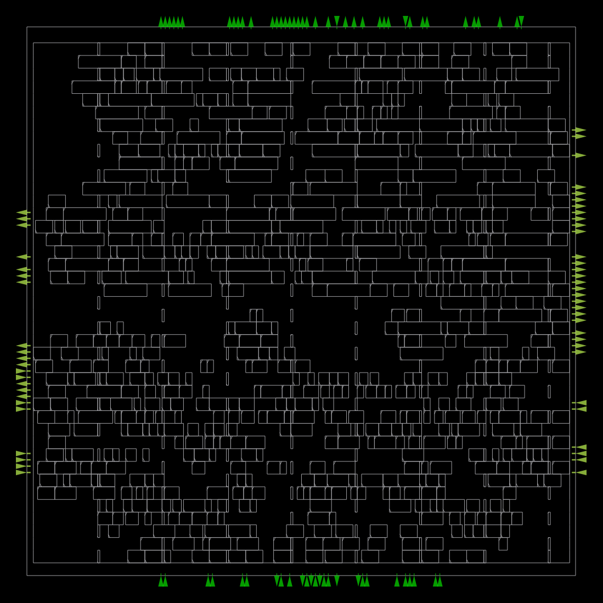
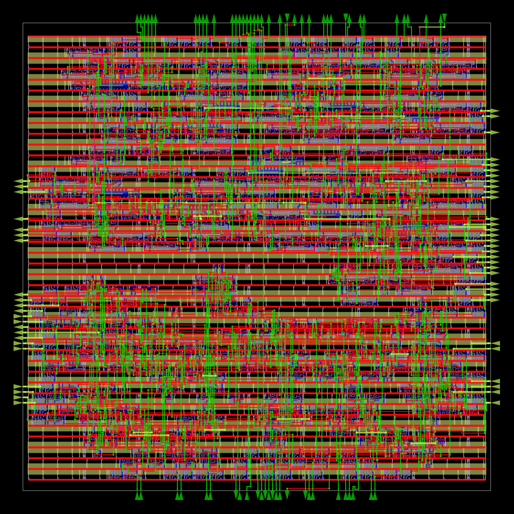
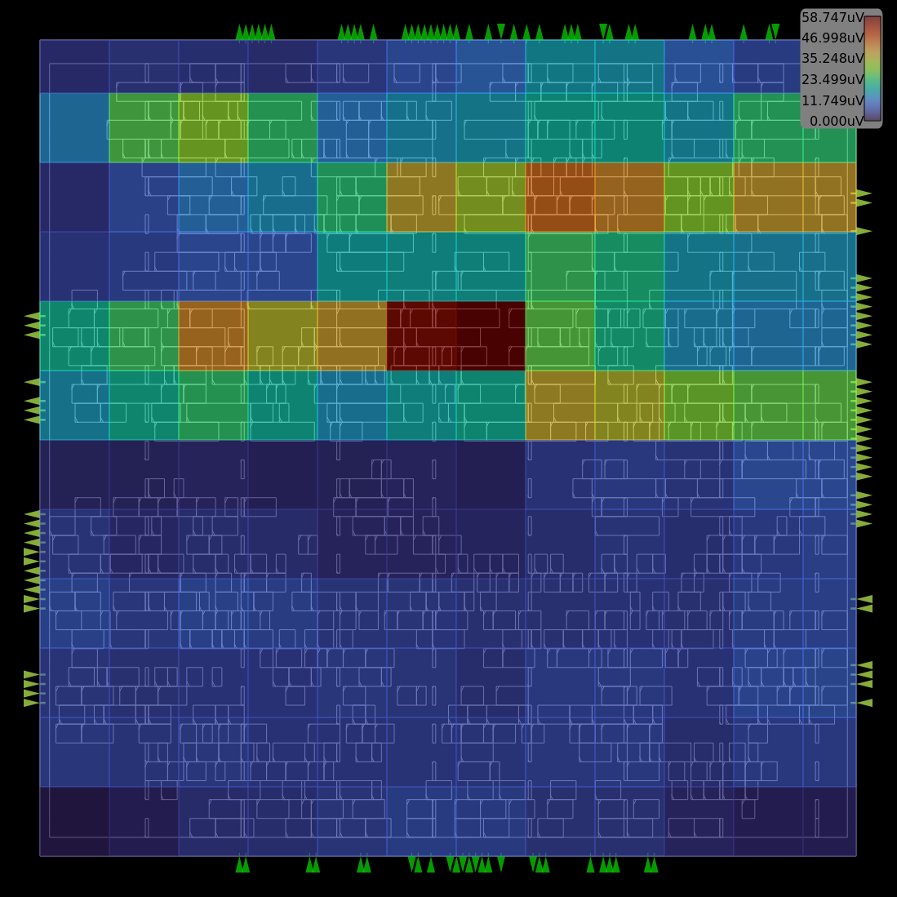
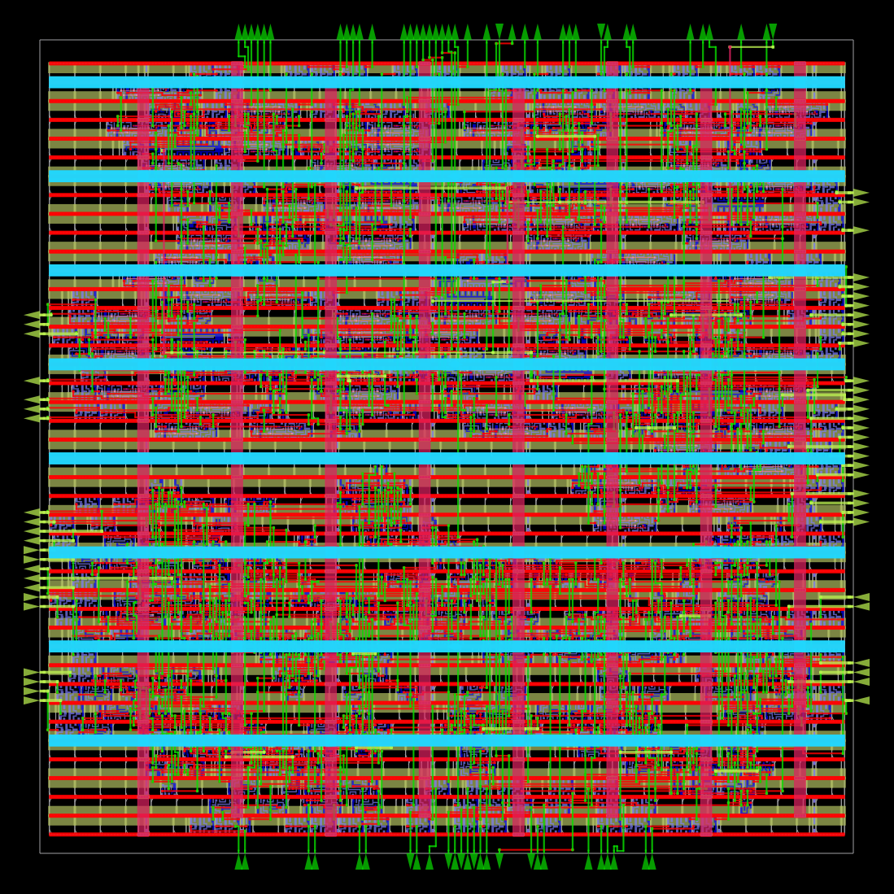
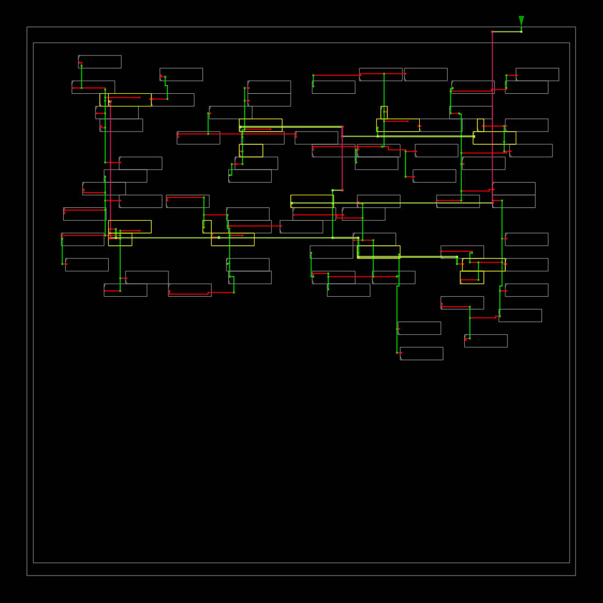
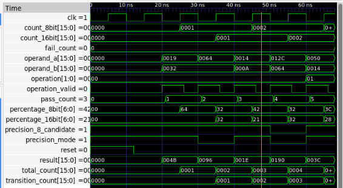

# Precision-Lock ALU

## Precision-Change Telemetry and Datapath Characterization

A Verilog-based VLSI project implementing a signed 16-bit arithmetic datapath with automatic 8-bit precision selection, 16-bit fallback, and precision transition telemetry.

## Project Features

- Signed 16-bit addition and subtraction.
- Automatic signed 8-bit operand eligibility detection.
- 16-bit fallback when the result exceeds the signed 8-bit range.
- Precision transition profiler.
- Counters for total, 8-bit, 16-bit and precision-transition operations.
- Optimized profiler architecture.

## Architecture

1. Precision Detector
2. Arithmetic Logic Unit
3. Precision Transition Profiler
4. Integrated Precision-Lock ALU System

## Tools and Technologies

- Verilog HDL
- Icarus Verilog
- GTKWave
- Yosys
- OpenROAD
- KLayout
- SKY130HD PDK

## Project Structure

- `rtl/`: RTL source code
- `testbench/`: Verilog testbenches
- `simulation/`: Simulation outputs and waveforms
- `synthesis/`: Synthesized netlists and reports
- `physical_design/config/`: OpenROAD configuration and timing constraints
- `physical_design/src/`: Physical-design RTL sources
- `physical_design/reports/`: Final physical-design report
- `physical_design/final_outputs/`: Final GDS, ODB, DEF, Verilog, SDC and SPEF files

## Physical Design Results

| Parameter | Result |
|---|---:|
| Technology | SKY130HD |
| Reported design area | 6,978 µm² |
| Clock period constraint | 20 ns |
| Reported minimum clock period | 8.42 ns |
| Corresponding estimated frequency | 118.78 MHz |
| Setup violations | 0 |
| Hold violations | 0 |
| Final GDS | Generated |
| Parasitic extraction | Completed |

These results are from the generated OpenROAD reports. The frequency is an estimate derived from the reported minimum clock period, not a measured silicon frequency.

## Final Physical Design Files

The `physical_design/final_outputs/` directory contains:

- `6_final.gds`: Final layout
- `6_final.odb`: OpenROAD physical database
- `6_final.def`: Physical placement and routing
- `6_final.v`: Gate-level Verilog
- `6_final.sdc`: Timing constraints
- `6_final.spef`: Extracted parasitic information

## Verification

RTL modules and integrated systems were verified using Icarus Verilog testbenches. Waveforms are available in `simulation/waveforms/`.

## Author

BOMMU GOWTHAM SAI REDDY

## License

No license has been assigned yet.

## Physical Design Visual Results

### Final Placement

### Final Routing

### IR Drop Analysis

### Complete Physical Design View

### Clock Distribution

## GTKWave Simulation Results

### Integrated Precision-Lock ALU System Waveform

